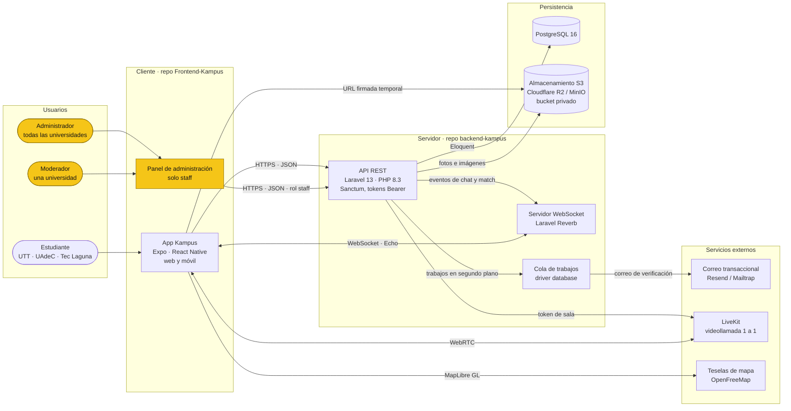
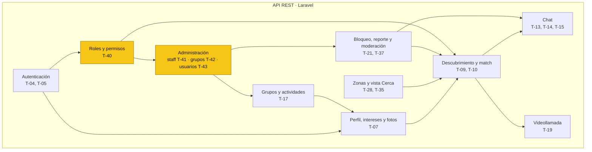
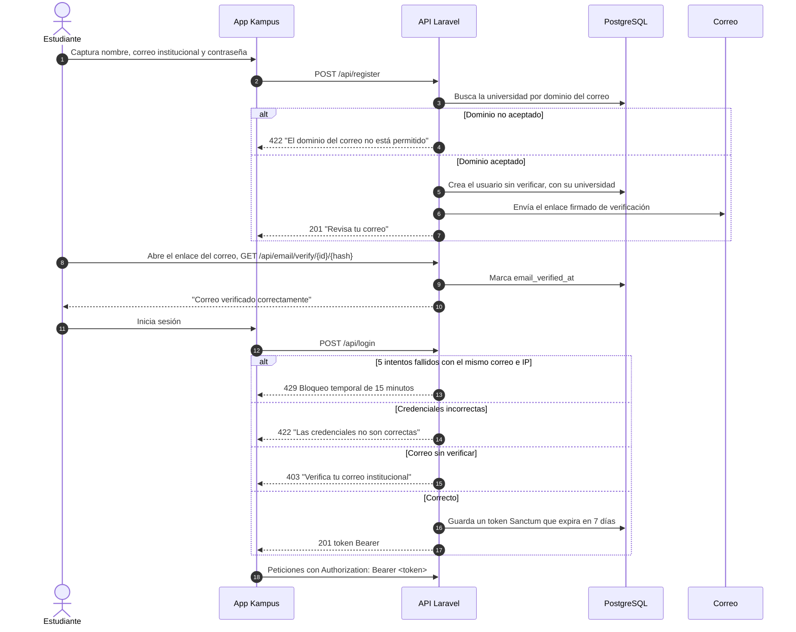

# Arquitectura del sistema — Kampus

Kampus usa una arquitectura **cliente-servidor desacoplada**: la app y la API viven en repositorios distintos y se comunican por HTTPS (JSON) y WebSocket. Así cada parte se desarrolla, prueba y despliega por separado (RNF-09).

> **Nuevo en Sprint 2 — Módulo de Administración.** Cambio de alcance aprobado el 19 de octubre de 2026. Se agregan los usuarios **Moderador** (una universidad) y **Administrador** (todas), que usan un **panel de administración** dentro de la app y no las funciones sociales. En la API se agrega el módulo **Administración** (T-40 a T-43). Lo nuevo va marcado con **[Nuevo]** y, en los diagramas, en amarillo.

## 1. Diagrama de componentes

| Componente | Tecnología | Responsabilidad | Requisitos |
|---|---|---|---|
| App Kampus | Expo / React Native (web y móvil) | Interfaz para estudiantes | RNF-01, RNF-08 |
| **[Nuevo]** Panel de administración | Mismas pantallas de Expo, con menú según el rol | Usuarios, reportes, grupos pendientes, grupos oficiales y gestión de staff (esta última solo para el administrador). El staff no ve Descubrir, Cerca ni Chat | RF-15, RF-22, RF-23, RF-24 |
| API REST | Laravel 13, PHP 8.3, Sanctum | Reglas de negocio, autenticación con tokens Bearer que expiran, validación. **[Nuevo]** Permisos por rol con *Policies* y filtro por universidad | RF-01 a RF-21, **[Nuevo]** RF-22 a RF-24, RNF-02 |
| Servidor WebSocket | Laravel Reverb + Echo | Mensajes de chat y avisos de match en tiempo real | RF-07, RF-08 |
| Cola de trabajos | Cola de Laravel (driver `database`) | Correo de verificación y tareas que no deben frenar la respuesta | RF-01 |
| Base de datos | PostgreSQL 16 | Datos del dominio; ver el DER en [`../base-de-datos/esquema.md`](../base-de-datos/esquema.md) | Todos |
| Almacenamiento | Bucket privado compatible con S3 | Fotos de perfil, de chat y de grupos, servidas con URL firmada temporal | RF-03, RF-09, RNF-03 |
| Correo | Resend (producción) / Mailtrap (pruebas) | Enlace de verificación institucional | RF-01 |
| Videollamada | LiveKit, detrás de un Adapter | Salas 1 a 1 solo entre usuarios con match | RF-10 |
| Mapa | MapLibre GL + teselas de OpenFreeMap | Vista "Cerca" con estilo oscuro propio | RF-19 |

## 2. Módulos de la API

Las flechas indican de qué módulo depende cada uno. Por ejemplo, el chat solo existe entre usuarios que hicieron match, y el bloqueo saca al usuario bloqueado del descubrimiento y del chat.

**[Nuevo]** **Roles y permisos (T-40)** es la base del módulo de Administración. Define tres roles (`student`, `moderator` y `admin`) y aplica dos reglas:
- el descubrimiento solo muestra estudiantes;
- cada moderador solo ve y atiende su universidad.

Encima de ese módulo, **Administración** concentra tres funciones:
- la gestión de cuentas de staff (T-41);
- la aprobación de grupos (T-42);
- la consulta y suspensión de usuarios reportados (T-43).

Toda acción del staff queda en la bitácora `moderation_actions`, con motivo obligatorio.

## 3. Flujo de registro, verificación e inicio de sesión

Es el primer flujo del MVP (Sprint 1, T-04 y T-05).

## 4. Despliegue previsto (T-24, Sprint 3)

- **Servidor:** VPS con Docker (Nginx, PHP-FPM, Reverb y PostgreSQL) y HTTPS obligatorio, porque cámara y micrófono lo exigen (riesgo R2).
- **CI:** GitHub Actions revisa formato (Pint), migraciones contra PostgreSQL y pruebas en cada PR hacia `develop` y `main`.

## 5. Decisiones que este diagrama refleja

| Tema | Decisión vigente | Nota |
|---|---|---|
| Base de datos | PostgreSQL 16 | El anteproyecto menciona MySQL en la sección 12.1; la decisión final es PostgreSQL (sección 12.3 y migraciones). |
| Frontend | Expo / React Native, que también corre en web | El anteproyecto dice "React 18 + Vite (SPA)"; el repositorio del frontend usa Expo. El equipo debe confirmarlo (ADR-001). |
| Ubicación | Zona declarada + celda geohash de precisión 6, sin PostGIS | Nunca se guarda la coordenada exacta de un usuario (RNF-11). |
| **[Nuevo]** Roles | Tres roles en `users.role`; un moderador tiene una sola universidad | El staff solo lo crea un administrador (comando `kampus:create-admin` para el primero) y usa correo institucional. Los permisos viven en *Policies*, no en el frontend. |
| Caché y colas | Driver `database`, sin Redis por ahora | Suficiente para 100 usuarios concurrentes (RNF-05); Redis entraría si Reverb necesita varios servidores. |
